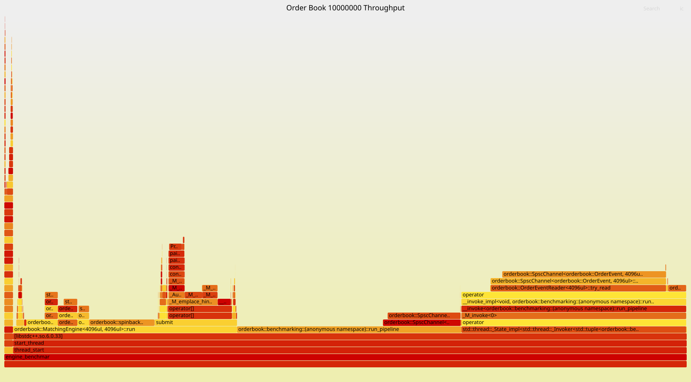
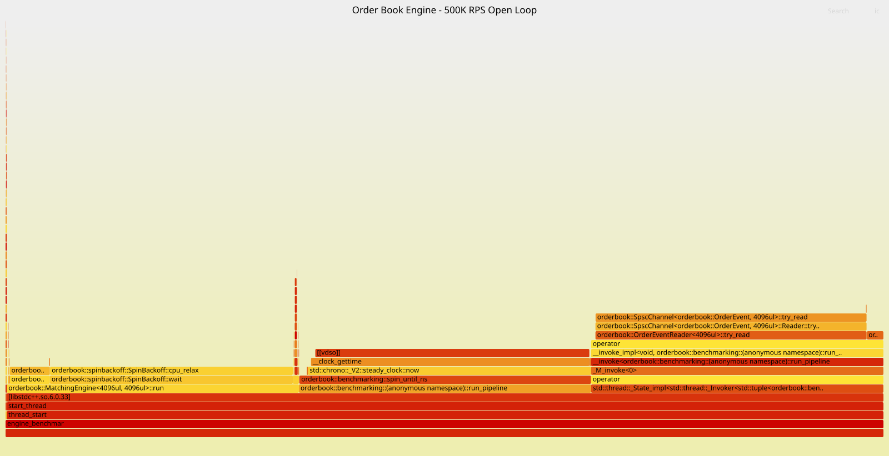

# Low-Latency-Order-Book

## 0x00 Description

**Low-Latency-Order-Book** is a C++17 limit-order-book and matching-engine prototype focused on deterministic ownership, cache-conscious price lookup, bounded message passing, and measurable latency under controlled load.

The project separates the matching core from its threaded transport:

- `OrderBook` implements price-time-priority matching and cancellation.
- `MatchingEngine` is the sole writer to the book.
- Two bounded SPSC channels carry flat request and event messages.
- GoogleTest validates matching rules and transport behavior.
- Google Benchmark measures the queue, the book, and the complete pipeline independently.

This is a systems-performance project and benchmark harness, not a production-ready exchange or trading platform.

### Features

- **Price-Time Priority**: Best price first, followed by FIFO arrival order at the same price.
- **Integer Representation**: Prices and quantities use signed 64-bit integers; matching never compares floating-point values.
- **64-Level Price Blocks**: Consecutive prices share one block and a 64-bit occupancy bitmap.
- **Prewarmed Price-Block Nodes**: Each side uses a single-threaded PMR pool whose map nodes are created and returned to the pool during startup for allocation-free reuse on the measured path.
- **Fast Best-Price Selection**: Bit scans select the highest bid or lowest ask inside the best active block.
- **Intrusive Price-Level FIFO**: Orders at one price are linked by indices stored in preallocated order nodes.
- **Fixed-Capacity Order Pool**: Filled and canceled order slots are recycled.
- **Indexed Cancellation**: An order-ID index locates active orders before unlinking them from their price level.
- **Single-Writer Engine**: Mutable order-book state needs no internal locks or atomics.
- **Directional Interfaces**: Request writers cannot read events, and event readers cannot submit requests.
- **Bounded CPU Spin Backoff**: Engine idle and event-backpressure waits use architecture-specific processor hints (`yield` on ARM and `pause` on x86) instead of entering the OS scheduler on supported targets.
- **Open-Loop Benchmarking**: Fixed-rate arrivals expose producer lateness, queue pressure, backlog, drain time, and latency percentiles.

### Current Matching Operations

- Add a limit order.
- Match across one or more resting orders.
- Preserve FIFO priority within a price level.
- Rest the unfilled quantity at the incoming order's original limit price.
- Cancel an active order by ID.
- Reject invalid, duplicate, or over-capacity orders.
- Emit trade and terminal order-state events.
- Stop the threaded engine through an ordered shutdown request.

---

## 0x01 Architecture and Data Layout

### Threaded Pipeline

```text
Order Producer
      |
      | OrderRequest (40 bytes)
      v
Bounded SPSC Request Channel
      |
      v
MatchingEngine Thread ---- owns ----> OrderBook
      |
      | OrderEvent (64 bytes)
      v
Bounded SPSC Event Channel
      |
      v
Event Consumer
```

The engine thread is the only thread allowed to mutate the book. The transport types make this direction explicit:

- `OrderRequestWriter` submits, cancels, and requests shutdown.
- `MatchingEngine` consumes requests and produces events.
- `OrderEventReader` consumes trades and acknowledgments.

The current design is SPSC because the measured pipeline has one producer. A multi-producer deployment would require one sequenced SPSC stream per producer or a bounded MPSC ingress queue.

### Order-Book Structure

```text
buy side / sell side
    |
    +-- std::pmr::map<BlockNumber, PriceBlock>
            |
            +-- 64-bit occupied-level bitmap
            +-- 64 directly indexed PriceLevel objects
                    |
                    +-- intrusive FIFO of OrderNode indices

order ID -- average O(1) index lookup --> OrderNode
```

Only non-empty price blocks remain in the ordered tree. Locating or creating a block is O(log B), where B is the number of active blocks. Selecting a price inside the chosen block is a constant-size bitmap operation. The node pool reuses order storage, although the separate `std::unordered_map` order index may still allocate internally.

### Matching Rules

1. A buy crosses while its limit is greater than or equal to the best ask.
2. A sell crosses while its limit is less than or equal to the best bid.
3. Better prices execute before worse prices.
4. Orders at one price execute in FIFO order.
5. A partially filled incoming order rests at its original limit.

`PriceTick` and `Quantity` are signed 64-bit integers. With cent ticks, `$99.95` is represented as `9995`. If quantities use four decimal places, `10.25` shares is represented as `102500`.

---

## 0x02 Developer Quick Start

### Platform Support

The core is portable C++17 and builds on Linux, macOS, and Windows with a conforming compiler. Exact benchmark CPU-ID binding is implemented for Linux. macOS runs are labeled `unpinned` because it does not expose the same affinity API.

### Requirements

- **CMake 3.16+**
- **C++17 compiler**
- **GoogleTest** when `ORDERBOOK_BUILD_TESTS=ON` (default)
- **Google Benchmark** when `ORDERBOOK_BUILD_BENCHMARKS=ON`

CMake searches for an installed Google Benchmark package and fetches version 1.9.4 when one is not available. GoogleTest is discovered through `find_package(GTest REQUIRED)`.

On macOS, GoogleTest can be installed with:

```bash
brew install googletest
```

### Build and Test

```bash
cmake -S . -B build -DCMAKE_BUILD_TYPE=Release -DORDERBOOK_BUILD_TESTS=ON -DORDERBOOK_BUILD_BENCHMARKS=ON
cmake --build build --parallel
ctest --test-dir build --output-on-failure
```

The current suite contains **19 GoogleTest cases** covering:

- price-time priority, partial fills, and non-crossing orders;
- cancellation, invalid input, capacity, and order-slot reuse;
- price-block boundaries, best-price lookup, and empty-block cleanup;
- SPSC capacity, FIFO order, and two-thread transfer;
- complete request-to-event engine behavior;
- fixed-rate scheduling and deterministic benchmark validation.

### Run Benchmarks

Run each executable separately so benchmark groups do not compete for CPU:

```bash
./build/benchmarks/spsc_benchmarks
./build/benchmarks/orderbook_benchmarks
./build/benchmarks/engine_benchmarks
```

Run only one engine mode:

```bash
./build/benchmarks/engine_benchmarks --benchmark_filter=Throughput
./build/benchmarks/engine_benchmarks --benchmark_filter=OpenLoop
```

### Benchmark Environment Variables

| Variable | Purpose |
| --- | --- |
| `ORDERBOOK_BENCHMARK_REQUESTS` | Engine measured-request count; default 200,000, maximum 10,000,000, multiple of four |
| `ORDERBOOK_BENCHMARK_TARGET_RPS` | Explicit open-loop arrival rate; bypasses automatic calibration |
| `ORDERBOOK_BENCHMARK_PRODUCER_CPU` | Linux logical CPU for the producer |
| `ORDERBOOK_BENCHMARK_ENGINE_CPU` | Linux logical CPU for the matching engine |
| `ORDERBOOK_BENCHMARK_CONSUMER_CPU` | Linux logical CPU for the consumer |

Example fixed-rate run with ten repetitions:

```bash
ORDERBOOK_BENCHMARK_REQUESTS=1000000 \
ORDERBOOK_BENCHMARK_TARGET_RPS=500000 \
./build/benchmarks/engine_benchmarks \
  --benchmark_filter='BM_Engine_Mixed_OpenLoop/95' \
  --benchmark_repetitions=10 \
  --benchmark_out=engine-open-loop.json \
  --benchmark_out_format=json
```

`/50`, `/70`, `/85`, and `/95` are benchmark registration parameters used by
automatic calibration. When `ORDERBOOK_BENCHMARK_TARGET_RPS` is set, the
explicit rate overrides that percentage for every instance. Selecting one
suffix therefore prevents four duplicate fixed-rate runs; `/95` does not mean
that the command above is applying 95% load.

---

## 0x03 Benchmarks

### Test Environment

Unless a subsection states otherwise, the Apple Silicon measurements below were collected on 2026-10-22 with the original OS-yield wait strategy:

| Component | Configuration |
| --- | --- |
| CPU | Apple M5 Pro, 15 cores |
| Memory | 24 GB |
| OS | macOS 26.7.1 |
| Compiler | Apple Clang 21.0.0 |
| Build | Release, `-O3 -DNDEBUG` |
| CPU binding | Unpinned |

Results are a reproducibility snapshot, not a latency SLA or a cross-machine comparison. macOS scheduling, background load, power state, and core placement can materially affect tail latency.

### 1. SPSC One-Item-in-Flight Handoff

Each payload performs 1,000,000 handoffs with 100,000 warmup items. One out of every 100 post-warmup handoffs is sampled, producing 9,000 latency samples. The producer waits for acknowledgment before sending the next sequence number, so this is a serialized handoff test rather than saturated queue throughput.

| Payload | Handoff Rate | P50 | P99 | Maximum | CV |
| --- | ---: | ---: | ---: | ---: | ---: |
| 16 bytes | 5.71M/s | 125 ns | 167 ns | 417 ns | 16.84% |
| 40 bytes | 5.80M/s | 166 ns | 209 ns | 5.58 us | 45.11% |

### 2. Core OrderBook Throughput

These tests call `OrderBook` directly without either SPSC channel. Each case contains 100,000 operations, including 10,000 warmup operations. Because individual operations can be shorter than the host clock tick, timing uses 16-operation batches and reports per-operation batch averages.

| Operation | Throughput | Batch P50 | Batch P99 | CV |
| --- | ---: | ---: | ---: | ---: |
| Resting add | 68.25M ops/s | 13 ns | 65 ns | 79.29% |
| Random cancellation | 25.14M ops/s | 39 ns | 75 ns | 40.30% |
| Single-maker match | 53.03M ops/s | 18 ns | 26 ns | 58.09% |
| Ten-maker sweep | 6.98M ops/s | 132 ns | 177 ns | 260.85% |

`Batch P50/P99` are distributions of batch averages, not request-level end-to-end percentiles. The large CV values reflect extremely short typical batches plus occasional operating-system outliers.

### 3. Complete Engine Pipeline

The complete benchmark runs separate producer, engine, and consumer threads through two 4,096-entry SPSC channels. It performs 20,000 warmup requests followed by 200,000 measured requests.

The deterministic four-request cycle is:

1. add a resting sell;
2. add a buy one tick below it;
3. add a matching buy at the sell price;
4. cancel the lower resting buy.

Each cycle produces four terminal acknowledgments and one trade event, then returns the book to empty.

The unpaced pipeline achieved:

| Metric | Result |
| --- | ---: |
| Median request throughput | **4.95M requests/s** |
| Median event throughput | **6.19M events/s** |
| Whole-run throughput CV | **0.72%** |
| Request size | 40 bytes |
| Event size | 64 bytes |

The unpaced producer intentionally saturates the bounded request queue. Failed enqueue attempts are counted as retries; requests are not dropped.

### 4. Open-Loop Scheduled Latency

Open-loop cases independently calibrate the unpaced pipeline and offer 50%, 70%, 85%, and 95% of the measured reference rate. Scheduled latency runs from the intended arrival time to the final acknowledgment.

| Load | Target | Achieved | P50 | P95 | P99 | P99.9 | Maximum | CV |
| ---: | ---: | ---: | ---: | ---: | ---: | ---: | ---: | ---: |
| 50% | 2.48M req/s | 2.48M req/s | 420 ns | 624 ns | 13.40 us | 126.06 us | 134.26 us | 585.10% |
| 70% | 3.44M req/s | 3.44M req/s | 428 ns | 550 ns | 11.58 us | 159.40 us | 179.45 us | 708.37% |
| 85% | 4.22M req/s | 4.22M req/s | 445 ns | 566 ns | 6.86 us | 49.69 us | 63.07 us | 380.87% |
| 95% | 4.67M req/s | 4.67M req/s | 464 ns | 3.42 us | 16.36 us | 104.97 us | 112.82 us | 475.90% |

All four runs completed without request-channel-full retries or dropped requests. Producer lateness of at least one interarrival interval was 0.30%-0.70%, and the observed post-window drain was 0-136 ns.

The sub-microsecond center and the large CV are compatible: rare macOS scheduling pauses are tens or hundreds of times larger than a normal request. The non-monotonic P99 values also show why one short, unpinned run must not be treated as a production tail-latency guarantee.

### 5. Matched CPU-Affinity Experiment

A second experiment was collected on 2026-10-23 under WSL on an Intel
Core i7-12800HX. Both configurations processed 1,000,000 measured requests
after 20,000 warmup requests at an explicit 500,000 requests/s arrival rate.
Each configuration ran ten repetitions, used 4,096-entry request and event
channels, and sampled every 127th request, producing 7,875 latency samples per
repetition.

The unpinned configuration allowed the Linux guest scheduler to place all
three threads. The affinity configuration requested logical CPU 2 for the
producer, CPU 4 for the matching engine, and CPU 6 for the event consumer.

| Metric | Unpinned | CPU 2/4/6 affinity | Change |
| --- | ---: | ---: | ---: |
| Completed request rate | 500.00K/s | 500.00K/s | Same |
| Output event rate | 625.00K/s | 625.00K/s | Same |
| Scheduled latency P50 | 467.0 ns | 471.5 ns | +1.0% |
| Scheduled latency P95 | 652.5 ns | 644.5 ns | -1.2% |
| Scheduled latency P99 | 24.752 us | 16.895 us | **-31.7%** |
| Scheduled latency P99.9 | 255.790 us | 246.467 us | -3.6% |
| Scheduled latency maximum | 540.652 us | 541.462 us | +0.1% |
| Admitted latency P99 | 9.763 us | 7.469 us | **-23.5%** |
| Submit lag P99 | 1.639 us | 1.321 us | **-19.4%** |
| Producer late by at least one interval | 0.953% | 0.888% | -6.8% |
| Sampled maximum requests in flight | 255.0 | 235.5 | -7.6% |
| Request-channel-full retries | 0 | 0 | Same |

Every table entry is the median of the ten per-repetition counters. In
particular, 16.895 us is the median of ten independently calculated P99 values,
not a percentile recomputed from one pooled sample set.

Affinity improved the typical P99 result but did not eliminate host-level tail
events. One affinity repetition recorded scheduled-latency P99/P99.9/maximum
of 124.166 us, 2.317 ms, and 3.805 ms. That outlier raised the across-run mean
and run-to-run variation even though the median result improved. WSL affinity
binds a thread to a Linux guest logical CPU; this experiment does not infer
bare-metal physical-core placement from the CPU numbers alone.

The result used in the resume is therefore stated precisely: at a matched
500K requests/s offered load, CPU affinity maintained 100% target throughput
with zero request-queue-full retries and reduced median per-run scheduled-to-ack
P99 from 24.75 us to 16.90 us, a 31.7% reduction.

### 6. OS Yield vs Bounded Spin Backoff

On 2026-10-24, the engine wait strategy was measured with a same-machine A/B
experiment on the Apple M5 Pro. Both variants used the same Release build mode,
an unpinned three-thread pipeline, 1,000,000 measured requests after 20,000
warmup requests, an explicit 500,000 requests/s arrival rate, two 4,096-entry
channels, and one sampled request per 127 requests. Each variant ran ten
repetitions.

The baseline called the operating-system scheduler when the engine request
channel was empty or the event channel was full. The current implementation
uses a bounded exponential spin capped at eight architecture-specific CPU hints
per wait call. The backoff resets after the engine receives a request.

| Metric | OS yield | Bounded spin backoff | Change |
| --- | ---: | ---: | ---: |
| Completed request rate | 500.00K/s | 500.00K/s | Same |
| Output event rate | 625.00K/s | 625.00K/s | Same |
| Scheduled latency P50 | 417 ns | 375 ns | **-10.1%** |
| Scheduled latency P95 | 500 ns | 458 ns | **-8.4%** |
| Scheduled latency P99 | 5.730 us | 3.584 us | **-37.5%** |
| Scheduled latency P99.9 | 26.313 us | 18.105 us | **-31.2%** |
| Scheduled latency maximum | 48.229 us | 43.167 us | **-10.5%** |
| Scheduled latency mean | 567.743 ns | 471.215 ns | **-17.0%** |
| Scheduled latency standard deviation | 1.523 us | 1.175 us | **-22.9%** |
| Scheduled latency CV | 276.72% | 250.39% | -26.33 percentage points |
| Admitted latency P99 | 5.209 us | 1.729 us | **-66.8%** |
| Admitted latency P99.9 | 25.979 us | 14.687 us | **-43.5%** |
| Sampled maximum requests in flight | 22.5 | 19.0 | **-15.6%** |
| Request-channel-full retries | 0 | 0 | Same |
| Requests remaining after drain | 0 | 0 | Same |

Each table entry is the median of the ten per-repetition counters. Percentile
changes compare the median of ten independently calculated per-run percentiles;
samples from separate repetitions were not pooled. Both variants sustained the
full target rate with no request-channel-full retries and no work remaining
after drain, so the latency reductions were not obtained by dropping requests
or reducing offered load.

### 7. Linux CPU-Clock Flame-Graph Profile

The complete three-thread pipeline was profiled on 2026-10-25 inside an ARM64 Ubuntu 24.04 Parallels guest with four virtual CPUs. The producer, engine, and consumer were bound to guest CPUs 1, 2, and 3. `perf record` sampled `cpu-clock` at 1,999 Hz with frame-pointer call graphs. Percentages below are inclusive flame-graph widths and therefore must not be added when one frame is nested inside another.

#### Saturated Throughput

The unpaced profile processed 10,000,000 measured requests after 20,000 warmup requests through two 4,096-entry SPSC channels.

| Metric | Result |
| --- | ---: |
| Mean request throughput | **5.767M requests/s** |
| Median request throughput | **5.750M requests/s** |
| Mean event throughput | **7.208M events/s** |
| Whole-run throughput CV | **0.85%** |
| Pending requests after the final enqueue | 4,086 / 4,096 |
| Requests remaining after drain | 0 |

The producer intentionally keeps the request channel nearly full in this test. The 429.3M failed enqueue attempts are tight-loop retry observations, not dropped requests. The benchmark registration currently fixes throughput repetitions at five, so the command-line request for fifty repetitions did not override the registered `Repetitions(5)` setting.



The graph combines three simultaneously running threads, each contributing approximately one third of all CPU-clock samples. A wide event-channel `try_read` frame is primarily the independently pinned consumer polling while it waits for the engine; it is not 25.72% of the matching thread's critical path.

| Inclusive frame | Whole-process width | Interpretation |
| --- | ---: | --- |
| `MatchingEngine::run` | 32.82% | Engine thread and its descendants |
| Event-channel `Reader::try_read` | 25.72% | Consumer polling on its own core |
| Request-channel `Writer::try_write` | 11.37% | Producer pressure against the saturated request queue |
| `OrderBook::submit` | 12.06% | Matching-core work |
| `PriceBlockTree::operator[]` | 9.37% | Price-block lookup or insertion |
| Red-black-tree emplacement | 7.25% | Ordered-map node insertion and rebalancing |
| `PriceBlock` construction | 1.81% | Initializing 64 price levels in a reused node |
| PMR `do_allocate` | 0.04%-0.27% | Pool bookkeeping is no longer a primary hotspot |
| `prewarm_blocks` | 0.01% | Startup work amortized across the long run |

Compared with the earlier same-guest throughput profile, inclusive `OrderBook::submit` width fell from 16.10% to 12.06%, `PriceBlock` construction fell from 6.33% to 1.81%, and map-node construction fell from 7.47% to 2.32%. End-to-end throughput remained effectively unchanged at approximately 5.77M requests/s, showing that pooling removed allocation work while ordered-tree insertion remained the next bottleneck. The earlier profile is retained at [assets/perf-engine-throughput-2026-10-24-12-28.svg](assets/perf-engine-throughput-2026-10-24-12-28.svg).

#### Fixed-Rate Open Loop

The open-loop profile processed 10,000,000 measured requests in each of nine repetitions at an explicit 500,000 requests/s. Every repetition achieved the target rate with zero request-channel-full retries and no work remaining after drain.

| Median per-run metric | Result |
| --- | ---: |
| Scheduled latency P50 | **460 ns** |
| Scheduled latency P95 | **629 ns** |
| Scheduled latency P99 | **3.963 us** |
| Scheduled latency P99.9 | **19.588 us** |
| Scheduled latency maximum | 1.824 ms |
| Admitted latency P50 | 333 ns |
| Admitted latency P99 | 2.875 us |
| Producer late by at least one interval | 0.868% |
| Sampled maximum requests in flight | 696 |
| Request-channel-full retries | 0 |



The fixed 500K/s arrival rate is only about 8.7% of the measured maximum throughput. Most samples therefore represent deliberate waiting: producer deadline polling in `spin_until_ns` accounts for 33.19%, its repeated `steady_clock::now` calls account for 32.24%, consumer event polling accounts for 30.88%, and engine `SpinBackoff::wait` accounts for 27.67%. Actual `OrderBook::submit` work is only 0.69% of whole-process samples at this offered load.

The earlier same-guest open-loop profile spent 31.09% of all samples in `sched_yield` and its kernel scheduling path. The current bounded processor-hint backoff removes that scheduler transition. Median scheduled latency improved from 709 ns / 1.046 us / 4.842 us / 20.668 us at P50/P95/P99/P99.9 to 460 ns / 629 ns / 3.963 us / 19.588 us. Rare virtual-machine scheduling stalls remain visible: the median per-run maximum increased from 1.658 ms to 1.824 ms, so the result describes improved typical latency rather than elimination of host-level tail events. The earlier profile is retained at [assets/perf-engine-open-loop-2026-10-24-12-20.svg](assets/perf-engine-open-loop-2026-10-24-12-20.svg).

### Open-Loop Timing Model

Arrival times are calculated from the original epoch:

```text
scheduled(index) = start + floor(index * 1,000,000,000 / requests_per_second)
```

Absolute deadlines prevent fractional nanosecond rounding from accumulating. When the producer is late or the request queue is full, the original schedule is retained so overload appears as lateness, backlog, and drain time.

For each sampled request:

```text
scheduled latency = submit lag + admission wait + admitted latency
```

The equality applies per request. Percentiles from the three component distributions must not be added together.

---

## 0x04 Project Layout

```text
include/orderbook/
├── engine.hpp                # request/event messages and engine loop
├── order_book.hpp            # order-book API and internal declarations
├── spsc_channel.hpp          # bounded SPSC ring and directional endpoints
└── types.hpp                 # shared scalar types

include/spinbackoff/
└── spin_backoff.hpp          # bounded ARM/x86 processor-hint backoff

src/
└── order_book.cpp            # matching, cancellation, blocks, and pool

tests/
├── order_book/               # matching, cancellation, capacity, blocks
├── channel/                  # SPSC correctness and two-thread transfer
├── engine/                   # complete engine integration
└── benchmarks/               # schedule and workload validation

benchmarks/
├── common/                   # clock, affinity, and statistics helpers
├── channel/                  # standalone SPSC handoff
├── order_book/               # direct OrderBook throughput
└── engine/                   # throughput and open-loop pipeline latency

assets/
├── perf-engine-throughput-*.svg  # saturated pipeline flame graphs
└── perf-engine-open-loop-*.svg   # fixed-rate pipeline flame graphs
```

The standalone SPSC benchmark includes only the channel header and benchmark helpers. It does not link the order-book or matching-engine implementation.

---

## 0x05 Scope and Roadmap

### Implemented

- Limit-order add, crossing, and multi-order matching.
- Partial fills and FIFO priority.
- Cancellation and price-level aggregation.
- Fixed-capacity rejection and order-slot reuse.
- Typed request/event transport and ordered shutdown.
- Deterministic event validation during performance tests.

### Planned / Production Gaps

- Replace/amend, market, IOC, FOK, and post-only orders.
- Self-trade prevention.
- Fully allocation-free active-order indexing.
- Multi-symbol partitioning and sequenced multi-producer ingress.
- Network protocol parsing and kernel-bypass I/O.
- Persistence, replay, snapshots, and recovery.
- Reference-model differential tests, fuzzing, and longer tail-latency runs.
- Bare-metal Linux measurements with verified physical-core isolation, IRQ placement, and controlled CPU frequency.
- Production telemetry, overload policy, and fault handling.
